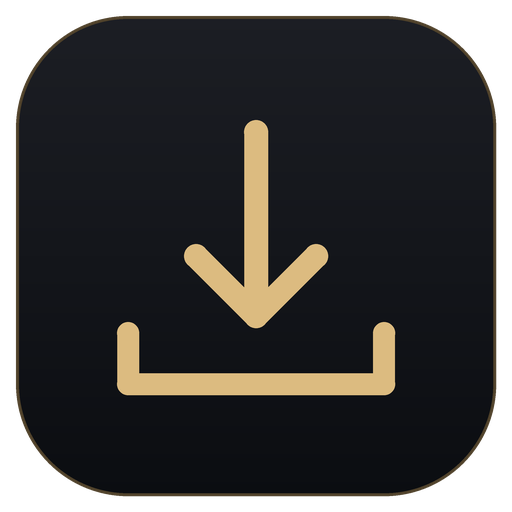
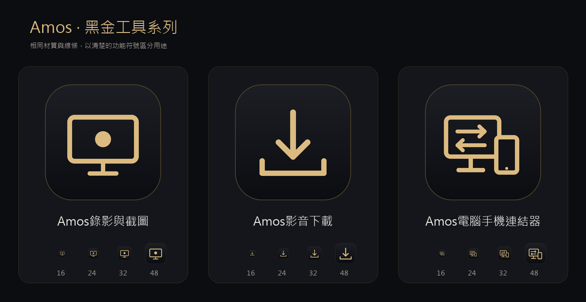

# Amos影音下載

**黑金極簡・原生 Windows 影音下載工作室**

Amos影音下載 是一款以 **Python + Tkinter** 打造的 Windows 桌面影音下載軟體，採用霧黑與香檳金的簡潔介面。貼上網址、選擇格式與儲存位置，就能在自己的電腦上處理影音下載、合併與轉檔。

**目前版本：v1.0.3** ｜ **支援系統：Windows 10／11（64 位元）** ｜ **介面語言：繁體中文**

> Amos影音下載 是原生桌面程式，不是 HTML 網站，也不需要另外開啟瀏覽器後端。請僅下載你擁有權利或已取得授權的影音內容。



## 下載與安裝

**[前往 GitHub Releases 下載最新版](../../releases/latest)**

下載頁面提供安裝精靈：

| 版本 | 檔案 | 使用方式 |
| --- | --- | --- |
| **一鍵安裝版（推薦）** | `AmosDownloader-Setup.exe` | 雙擊安裝，依精靈指示完成安裝 |

### 一鍵安裝版

1. 在 **Releases** 頁面下載 `AmosDownloader-Setup.exe`。
2. 雙擊執行安裝程式，依照繁體中文安裝精靈操作。
3. 安裝時預設勾選建立桌面捷徑；開始功能表會加入 Amos影音下載。
4. 安裝完成後，從桌面或開始功能表啟動程式。

安裝版已設計為隨程式封裝 **yt-dlp、FFmpeg、FFprobe、Deno 與 Python/Tk 執行環境**；一般使用者不需另外安裝 Python、手動設定 PATH 或啟動 HTTP 後端。首次使用影音網站仍需要可用的網路連線。

預設安裝位置：`%LOCALAPPDATA%\Programs\Aureate`。

**注意：** 安裝檔若尚未取得程式碼數位簽章，Windows 可能顯示安全警告。請核對下載來源與發佈者提供的 SHA-256；不要為了安裝而停用防毒軟體。

v1.0.3 更新：統一 Amos 名稱與黑金圖示，保留原有設定、下載紀錄與安裝位置。

## 主要功能

- **原生黑金介面**：以 Tkinter 製作，無 HTML、Electron 或 WebView。
- **整區可點擊的網址輸入框**：v1.0.3 已改善「新增下載」區域，支援直接輸入、`Ctrl + V`、右鍵貼上及每行一個網址。
- **影音格式**：MP4 影片；MP3、M4A、FLAC、WAV 音訊輸出。
- **畫質選擇**：最佳來源畫質，或限制最高為 2160p、1440p、1080p、720p、480p（以來源實際提供的格式為準）。
- **批次下載與佇列**：一次輸入多個網址，依序處理，可取消失敗或進行中的任務並重試。
- **真實下載狀態**：顯示下載與合併進度，不使用假下載動畫；成功後檢查檔案是否存在並透過 FFprobe 驗證。
- **自訂儲存位置**：使用 Windows 原生資料夾選擇視窗，選擇 C 槽、D 槽或其他可用位置。
- **完成紀錄**：可開啟已下載檔案及資料夾；清除紀錄不會刪除實際影片。
- **本機引擎管理**：提供手動更新、回復與診斷功能。

> FLAC、WAV 是輸出格式；把有損來源轉成這些格式，不會自動變成真正的無損音質。MP4 的可播放性也可能受來源編碼與播放器影響。

## 支援來源與限制

Amos影音下載 主要支援 **YouTube 一般影片、YouTube Shorts、YouTube Music**。其他 HTTP(S) 影音網址可交由 yt-dlp 嘗試解析，但**不保證每個網站都支援**。

目前版本不提供 Instagram、Facebook、TikTok 或抖音下載，也不會自動展開整份播放清單。受 DRM、地區、登入權限、網站規則或來源更新限制的內容，可能無法下載。

## 使用教學

1. 開啟 Amos影音下載，進入「**下載工作台**」。
2. 點擊「**新增下載**」區域的任意輸入位置，貼上完整網址；多個網址請分行輸入。
3. 選擇影片／音訊模式，以及畫質或音訊輸出格式。
4. 選擇要儲存的資料夾，按「**開始下載**」。
5. 於右側佇列查看實際下載狀態；完成後可至「**完成紀錄**」開啟檔案。

常用快捷鍵：`Ctrl + L` 聚焦網址欄、`Ctrl + Enter` 開始下載、`Ctrl + V` 貼上。

「暫停接續」會停止**後續任務**開始排程，不會自動暫停正在下載的檔案；要停止當前任務，請按該任務的「取消」。中斷後能否續傳取決於來源與串流類型。

## 隱私與資料儲存

- 下載與轉檔在**使用者自己的 Windows 電腦**上執行，不需要連接開發者架設的 HTTP 下載後端。
- 設定和任務紀錄儲存在 `%LOCALAPPDATA%\AureateDesktop`；媒體檔案儲存在你自行選擇的資料夾。
- 軟體不會自動讀取瀏覽器 Cookie；需要登入的來源，可由使用者自行選擇 Netscape 格式 `cookies.txt`，僅供當次工作階段使用。
- 任務紀錄可能包含影片網址或本機路徑；**不要把個人紀錄、Cookie 或私人連結公開上傳 GitHub**。
- 解除安裝後，使用者下載的影音與個人設定／紀錄不會自動刪除。

## 常見問題

**Q：需要安裝 Python 或 FFmpeg 嗎？**  
A：使用正式安裝版或完整免安裝包時，不需要；這些元件由發佈包提供。只有自行從原始碼建置的開發者需要安裝 Python。

**Q：為什麼某些 YouTube 影片無法下載？**  
A：可能與來源限制、登入、地區、網路、DRM 或解析引擎版本有關。可先查看「引擎與設定」及錯誤紀錄，再視需要手動更新解析引擎；更新也不保證所有來源可用。

**Q：為什麼沒有桌面捷徑？**  
A：安裝時若未勾選建立桌面捷徑，可從 Windows 開始功能表開啟 Amos影音下載。

**Q：免安裝版能否只保留 `Aureate.exe`？**  
A：不能。必須保留解壓縮後的整個 `Aureate` 資料夾，包含 `_internal`、`bin` 等必要檔案。

**Q：下載的影片存在哪裡？**  
A：由你在下載工作台選擇的資料夾決定；也可以從「完成紀錄」開啟。

## 開發者：從原始碼建置

### 建置需求

- Windows 10／11 x64
- Python **3.12 或 3.13 x64**（包含 pip 與 Tcl/Tk）
- 首次下載依賴及下載引擎時需要網路

原始碼專案提供以下建置入口：

| 檔案 | 用途 |
| --- | --- |
| `BUILD_SETUP.cmd` | 從目前原始碼重新建置完整 Windows 一鍵安裝程式 |
| `BUILD_WINDOWS.cmd` | 建立 Windows 免安裝版 |
| `RESUME_SETUP.cmd` | 僅在未修改程式碼、且既有 `dist/Aureate` 通過完整驗證時，接續安裝器建置 |
| `RUN_SOURCE.cmd` | 從原始碼啟動程式（開發用途） |

從專案根目錄執行 `BUILD_SETUP.cmd`；成功後安裝程式會位於：

```text
release/AmosDownloader-Setup.exe
```

**如果修改過 UI、下載功能或其他程式碼，請使用 `BUILD_SETUP.cmd` 完整重建，不能直接重新封裝舊的 `dist/Aureate`。**

開發測試指令：

```powershell
python -m unittest discover -s tests -v
python main.pyw --ui-smoke --report ui-smoke.json
```

其他建置及驗收細節請參考 [`docs/INSTALL_SETUP_AND_GITHUB.md`](docs/INSTALL_SETUP_AND_GITHUB.md)。

### GitHub Actions / Releases

本專案內含 `.github/workflows/build-windows.yml`，支援在 GitHub Actions 的 Windows 建置環境中打包並進行安裝／解除安裝測試。手動執行工作流程會產生建置附件；推送符合版本的 Git tag 且測試通過後，流程只會建立 **Draft Release（草稿）**，需要維護者自行驗收並按下發佈。

例如正式發布 v1.0.3 時，使用 `v1.0.3` 標籤，並將 `AmosDownloader-Setup.exe` 放到 **Releases 的 Assets**，**不要**把大型安裝檔提交到原始碼根目錄。

## 驗證與已知限制

本專案包含介面、下載邏輯、影音處理與安裝器的自動化測試。v1.0.3 已有本機測試及 Windows 安裝器建置的成功回報，但**不等於所有 Windows 裝置與所有線上影音來源都已驗證**。

公開發佈前，建議在另一台沒有預裝 Python、FFmpeg、Deno 的 Windows 10／11 x64 電腦，實際測試安裝、桌面捷徑、MP4、MP3、取消、重試、解除安裝及下載路徑。若發佈檔未數位簽章，也應明確告知使用者。

## 授權與聲明

Amos影音下載 自行撰寫的應用程式程式碼採用 **MIT License**，詳見 [`LICENSE.txt`](LICENSE.txt)。yt-dlp、FFmpeg、Deno、Python/Tk 與相關工具依各自授權條款使用；第三方資訊見 [`THIRD_PARTY_NOTICES.md`](THIRD_PARTY_NOTICES.md)。

本工具只應用於你有權儲存或使用的內容。請遵守著作權法、來源網站服務條款與當地法規。軟體不提供繞過 DRM 的保證或功能。

---

**Amos影音下載 v1.0.3 — 簡潔的介面，真正的本機下載。**

## Amos 工具系列



| 工具 | 功能 | Windows 安裝精靈 |
| --- | --- | --- |
| Amos錄影與截圖 | 螢幕錄影、範圍與視窗截圖 | [下載](https://github.com/stu310101-arch/screen_recoder/releases/latest/download/AmosRecorder-Setup.exe) |
| Amos影音下載 | 影音下載、合併與轉檔 | [下載](https://github.com/stu310101-arch/AUREATE/releases/latest/download/AmosDownloader-Setup.exe) |
| Amos電腦手機連結器 | 電腦與手機互傳檔案、文字 | [下載](https://github.com/stu310101-arch/aureo-link/releases/latest/download/AmosLink-Setup.exe) |

三款採用統一黑金圖示。下載後執行安裝精靈，預設勾選建立桌面捷徑，也會加入開始功能表與 Windows 解除安裝清單。

圖示修正：桌面與開始功能表捷徑直接使用已安裝、帶版本號的獨立黑金 ICO，避免沿用舊版 EXE 圖示快取。請執行最新版安裝精靈並保留「建立桌面捷徑」勾選。
